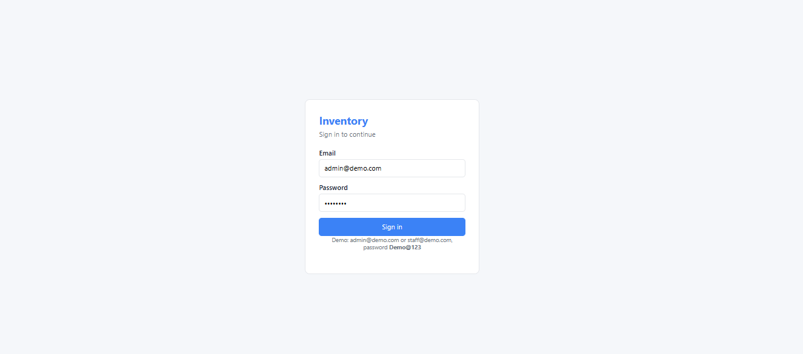
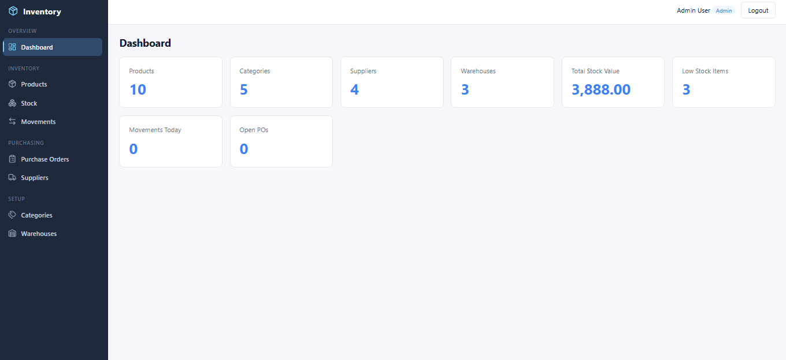
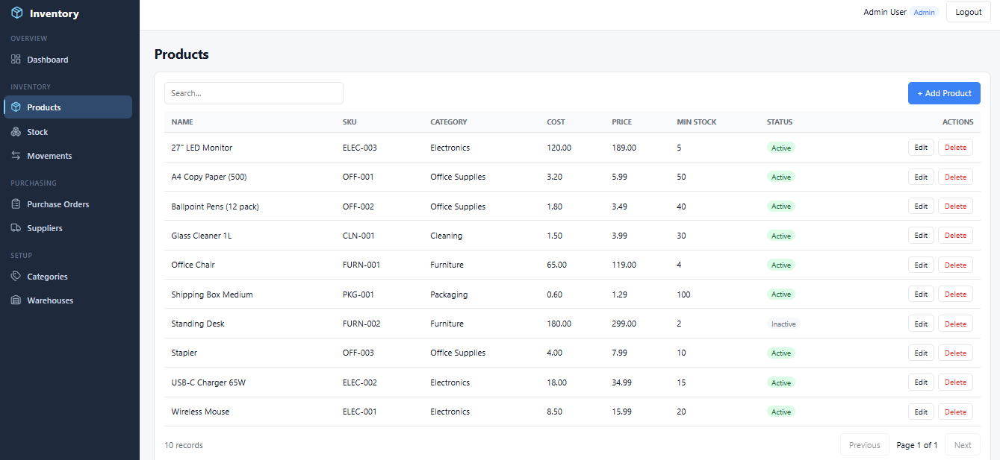
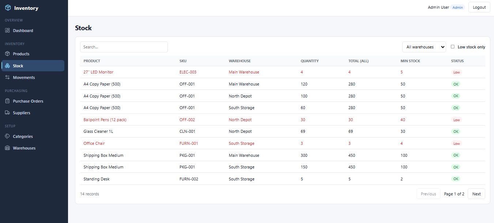
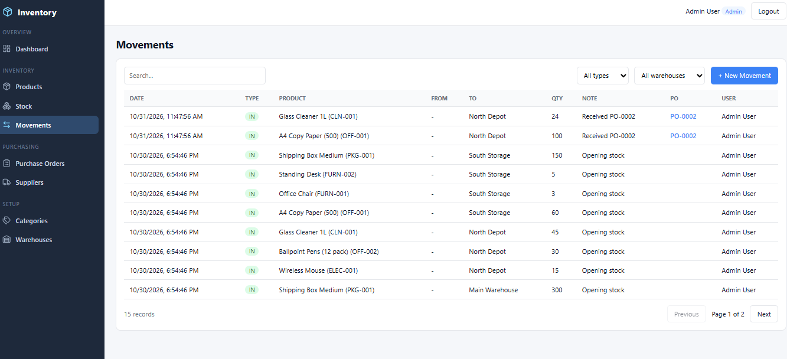
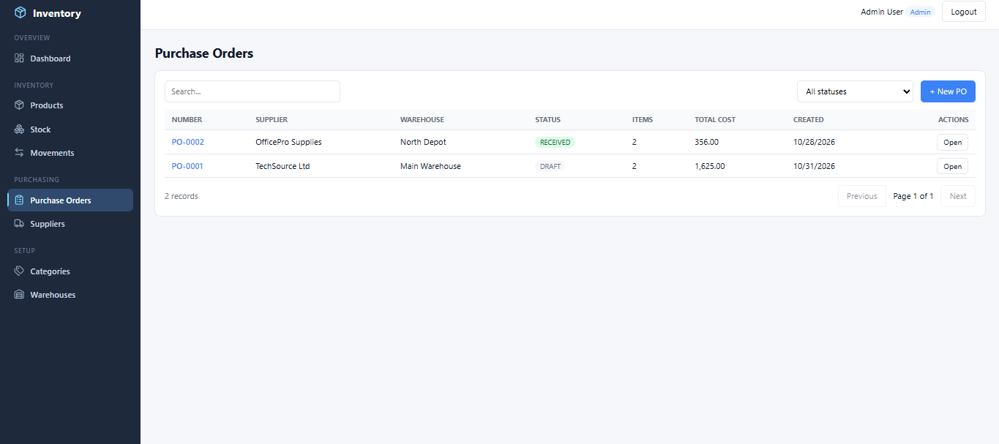

# Inventory Management System

A simple inventory admin app.

- **Phase 1:** products, categories, suppliers, warehouses, login
- **Phase 2:** stock per warehouse and stock movements (IN, OUT, TRANSFER, ADJUST)
- **Phase 3:** purchase orders (create, order, receive into stock, cancel)

- **api/**: ASP.NET Core Web API (.NET 10) using Dapper, SQL Server, JWT and BCrypt
- **web/**: React + TypeScript (Vite) using React Router and Axios
- **database/**: `database.sql` (Phase 1 tables and demo data), `phase2.sql` (stock tables and starting stock)
  and `phase3.sql` (purchase order tables and 2 demo POs)
- **api.Tests/**: xUnit tests for the stock rules
- `docker-compose.yml`, `api/Dockerfile`, `web/Dockerfile`, `database/Dockerfile`: run everything with Docker

## Screenshots

| Login | Dashboard |
| ----- | --------- |
|  |  |
| **Products** | **Stock** |
|  |  |
| **Movements** | **Purchase Orders** |
|  |  |

## Run with Docker

Needs only Docker (Docker Desktop on Windows/macOS). Run these from the `inventory-system` folder.

The first time after cloning, create `.env` from the example (`.env` holds the secrets and is in `.gitignore`):

```
cp .env.example .env
```

Open `.env` and replace `MSSQL_SA_PASSWORD` and `JWT_KEY`. Generate a JWT key with:

```
node -e "console.log(require('crypto').randomBytes(48).toString('base64'))"
```

Then start everything:

```
docker compose up
```

- Web app: http://localhost:5173 (log in with a [demo login](#demo-logins))
- API / Swagger: http://localhost:5000/swagger
- SQL Server: `localhost,1433`, user `sa`, password from `.env`

On the first run the `db` container creates `InventoryDb` and runs `database.sql`, `phase2.sql` and `phase3.sql`.
The API starts only after that has finished. Later runs keep the data and skip the seed.
The web container serves the built React app with nginx and forwards `/api` to the API container.

If a port is already taken, change `WEB_PORT`, `API_PORT` or `DB_PORT` in `.env`.

Other commands:

```
docker compose up --build    # rebuild after changing code
docker compose down          # stop (data is kept)
docker compose down -v       # stop and delete the database; the next "up" seeds it again
```

## Run tests

Needs the .NET 10 SDK and Docker running. The tests start their own temporary SQL Server container
(built from the same three scripts), so they never touch your real database or the `docker compose` one.

```
dotnet test api.Tests
```

The tests in `api.Tests/StockRulesTests.cs` call the real API (`POST /api/movements`) and check that:

- OUT more than the available stock is rejected (400) and nothing changes
- TRANSFER to the same warehouse is rejected (400)
- ADJUST as Staff returns 403 (and works as Admin)
- stock never goes below 0 (OUT, TRANSFER, ADJUST and the database CHECK constraint)
- many OUT requests sent at the same moment cannot sell more than is in stock

One test is skipped on purpose: concurrent OUT and TRANSFER requests for the same product can deadlock
in SQL Server, and the requests that lose get a 500 instead of a 400. Stock is still never oversold.
The skip reason in the test explains it.

## Requirements (without Docker)

- .NET 10 SDK
- Node.js 20.19+ (or 22+)
- SQL Server (Express, Developer or LocalDB)

## 1. Create the database

Run `database/database.sql` in SQL Server Management Studio, Azure Data Studio, or sqlcmd:

```
sqlcmd -S localhost\SQLEXPRESS -E -C -i database/database.sql
```

This creates the `InventoryDb` database with its tables and demo data.
**Running it again drops and recreates the tables, which deletes all their data.**

Then run `database/phase2.sql`:

```
sqlcmd -S localhost\SQLEXPRESS -E -C -i database/phase2.sql
```

This adds the `Stock` and `StockMovements` tables and some starting stock, which is recorded as `IN` movements.

Then run `database/phase3.sql`:

```
sqlcmd -S localhost\SQLEXPRESS -E -C -i database/phase3.sql
```

This adds the `PurchaseOrders` and `PurchaseOrderItems` tables and a `PurchaseOrderId` column on `StockMovements`.
It also creates 2 demo POs: PO-0001 is a DRAFT, and PO-0002 is RECEIVED, with its goods added to stock as `IN` movements.

`phase2.sql` and `phase3.sql` do not touch existing data and are safe to run more than once.
To reset everything, run all three scripts again in order.

## 2. Create `api/appsettings.Development.json`

This file holds your local settings. It is in `.gitignore`, so it is never committed and you have to create it yourself after cloning.

First generate a random key:

```
node -e "console.log(require('crypto').randomBytes(48).toString('base64'))"
```

Then create `api/appsettings.Development.json` and paste the key in:

```json
{
  "ConnectionStrings": {
    "Default": "Server=localhost\\SQLEXPRESS;Database=InventoryDb;Trusted_Connection=True;TrustServerCertificate=True"
  },
  "Jwt": {
    "Key": "<paste your generated key here>"
  }
}
```

`dotnet run` loads this file on top of `api/appsettings.json`, because `api/Properties/launchSettings.json` sets the environment to `Development`.

The API will not start if `Jwt:Key` is missing, is still the placeholder from `appsettings.json`, or is shorter than 32 characters. It prints an error saying which one it is.
Anywhere other than your own machine, set the key with the `Jwt__Key` environment variable instead of this file.

Other servers:
- Default instance: `Server=localhost;...`
- LocalDB: `Server=(localdb)\\MSSQLLocalDB;...`
- SQL login: `Server=localhost;Database=InventoryDb;User Id=sa;Password=...;TrustServerCertificate=True`

## 3. Run the API

```
cd api
dotnet run
```

The API runs at http://localhost:5000. You can try it in Swagger at http://localhost:5000/swagger
(log in with `POST /api/auth/login`, then paste the token into **Authorize**).

## 4. Run the web app

```
cd web
npm install
npm run dev
```

Then open http://localhost:5173

If the API runs on a different address, create `web/.env` with
`VITE_API_URL=http://localhost:5000/api`.

## Demo logins

| Email          | Password | Role                         |
| -------------- | -------- | ---------------------------- |
| admin@demo.com | Demo@123 | Admin (can delete, can ADJUST stock)              |
| staff@demo.com | Demo@123 | Staff (view, add, edit; IN / OUT / TRANSFER only) |

## API overview

All endpoints need `Authorization: Bearer <token>` except login.

| Method | URL                       | Notes                                   |
| ------ | ------------------------- | --------------------------------------- |
| POST   | /api/auth/login           | `{ email, password }` → `{ token, user }` |
| GET    | /api/auth/me              | current user                            |
| GET    | /api/{resource}           | `?search=&page=&pageSize=` → `{ items, total }` |
| GET    | /api/{resource}/{id}      |                                         |
| POST   | /api/{resource}           |                                         |
| PUT    | /api/{resource}/{id}      |                                         |
| DELETE | /api/{resource}/{id}      | Admin only                              |

`{resource}` is `products`, `categories`, `suppliers` or `warehouses`.
Errors come back as `{ "message": "..." }`.

### Stock (Phase 2)

| Method | URL                 | Notes                                                                   |
| ------ | ------------------- | ----------------------------------------------------------------------- |
| GET    | /api/stock          | `?search=&warehouseId=&lowOnly=&page=&pageSize=`                        |
| GET    | /api/stock/summary  | `{ totalStockValue, lowStockCount, movementsToday }`                    |
| GET    | /api/movements      | `?search=&type=&warehouseId=&from=&to=&page=&pageSize=`, newest first   |
| POST   | /api/movements      | `{ type, productId, fromWarehouseId, toWarehouseId, quantity, note }`   |

Movement rules:

- **IN**: adds `quantity` to `toWarehouseId`.
- **OUT**: removes `quantity` from `fromWarehouseId`.
- **TRANSFER**: moves `quantity` from `fromWarehouseId` to `toWarehouseId`. The two must be different.
- **ADJUST** (Admin only): sets the stock in `toWarehouseId` to the counted `quantity`.
  The difference is saved as the movement, with the note `counted X`.
  It appears under **To** if stock went up and under **From** if it went down.
- Stock can never go below 0. If it would, the API returns 400 `Not enough stock. Available: X`.
- Each movement runs in one transaction that locks the stock rows, so requests made at the same time cannot overspend stock.
- The user is taken from the login token. Movements cannot be edited or deleted.
- A product is **low** when its total quantity across all warehouses is at or below its Min Stock.

### Purchase orders (Phase 3)

| Method | URL                                 | Notes                                                                  |
| ------ | ----------------------------------- | ---------------------------------------------------------------------- |
| GET    | /api/purchase-orders                | `?search=&status=&supplierId=&page=&pageSize=` (`status=OPEN` = ORDERED + PARTIAL) |
| GET    | /api/purchase-orders/{id}           | header + items (ordered, received, remaining, unit cost, line total)   |
| POST   | /api/purchase-orders                | `{ supplierId, warehouseId, note, items: [{ productId, quantity, unitCost }] }` |
| PUT    | /api/purchase-orders/{id}           | same body, DRAFT only                                                  |
| POST   | /api/purchase-orders/{id}/order     | Admin, DRAFT → ORDERED                                                 |
| POST   | /api/purchase-orders/{id}/cancel    | Admin, only if nothing has been received                               |
| POST   | /api/purchase-orders/{id}/receive   | `[{ itemId, quantity }]`, ORDERED or PARTIAL only                      |

Status flow: `DRAFT → ORDERED → PARTIAL → RECEIVED`, or `DRAFT / ORDERED → CANCELLED`.

- Staff and Admin can create and edit a PO while it is DRAFT. Only Admin can mark it ordered or cancel it.
- Receiving cannot exceed what is still remaining on a line.
  Each received line adds stock to the PO's warehouse as an `IN` movement with the note `Received PO-0001`.
  The PO then becomes PARTIAL or RECEIVED.
- A receive runs in one transaction that locks the PO, so two receives at the same time cannot over-receive.
  If any line is invalid, nothing is saved.
- PO numbers (`PO-0001`, ...) are generated by the database from the Id.

## Not built yet

Reports and refresh tokens are planned for later phases.
